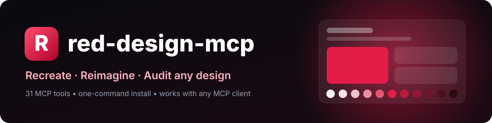
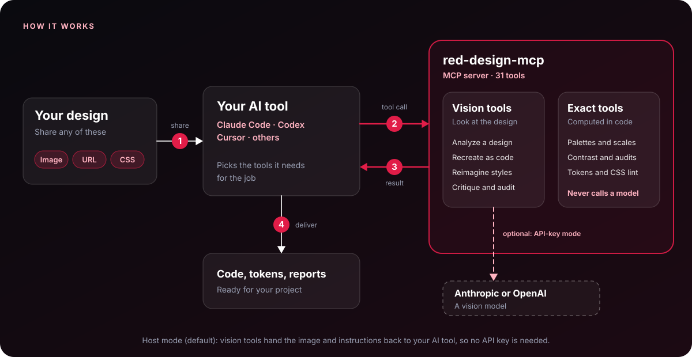

<div align="center">



<br/>

[](https://www.npmjs.com/package/red-design-mcp)
[](https://www.npmjs.com/package/red-design-mcp)
[](https://nodejs.org)
[](./LICENSE)
[](https://www.typescriptlang.org)
[](#contributing)


### Give your AI tools a designer's eye.

Analyze, recreate, reimagine, critique and audit **any design** straight from Claude Code, Codex, Cursor and every other MCP client.

[**Quick start**](#quick-start) · [**Tools**](#tools) · [**Examples**](#example-prompts) · [**How it works**](#how-it-works) · [**Roadmap**](#roadmap)

</div>

---

## Why red-design-mcp?

| | |
|---|---|
| **One command** | `npx red-design-mcp install` configures every AI tool it finds. No JSON editing. |
| **No API key needed** | In host mode your AI tool does the seeing, so there is no second bill and no second key. |
| **Math, not vibes** | Contrast ratios, palettes, color-blindness simulation, type scales and originality scores are computed in code, so they are exact and repeatable. |
| **Whole design system in one call** | `generate_design_system` turns a brand color and a mood into palette, light and dark themes, fonts, fluid type, spacing, radii and shadows, with contrast verified. |
| **Agents included** | 13 specialist agents for Claude Code, Cursor, Codex, Gemini CLI and Copilot (plus AGENTS.md), 7 one-command workflows, and an autonomous `audit_site`. |
| **Reverse-engineer any website** | Point it at a URL: it reads the live CSS for tokens, lints it, or screenshots the page for the vision tools. |
| **Tools on demand** | Let your AI discover and run only the tools a task needs with `RED_TOOLS=auto`, or pin the groups you want yourself. |
| **Inspiration dial** | Slide from a faithful rebuild (0) to a wild reinterpretation (100) and get up to 3 variations at once. |
| **Accessible by default** | Recreations fix contrast, semantics and tap targets unless you say otherwise. |
| **Any model, any client** | Use Anthropic, OpenAI, Google Gemini, Groq, OpenRouter, a local model through Ollama, or any OpenAI-compatible endpoint. Or let your host model handle it. Works over standard MCP stdio. |

## Quick start

```bash
npx red-design-mcp install
```

That's it. The installer detects **Claude Code, Codex, Cursor and Claude Desktop**, adds the server, backs up any config it edits (`.bak`), and never touches your other servers. Restart your AI tool and try:

> *"Analyze `./screens/pricing.png` and recreate it in Tailwind."*

<details>
<summary><b>Install options and manual setup</b></summary>

<br/>

```bash
npx red-design-mcp install                    # auto-detect your tools
npx red-design-mcp install --client codex,cursor
npx red-design-mcp install --all              # every supported client
npx red-design-mcp install --print            # just show the config snippets
npx red-design-mcp doctor                     # check Node, mode and detected clients
npx red-design-mcp doctor --check             # also confirm your model still exists
npx red-design-mcp agents                     # install 13 design agents for your AI tools
```

**Claude Code**

```bash
claude mcp add --scope user red -- npx -y red-design-mcp
```

**Codex** (`~/.codex/config.toml`)

```toml
[mcp_servers.red]
command = "npx"
args = ["-y", "red-design-mcp"]
```

**Cursor, Claude Desktop and any other MCP client**

```json
{
  "mcpServers": {
    "red": { "command": "npx", "args": ["-y", "red-design-mcp"] }
  }
}
```

On Windows, use `"command": "cmd"` with `"args": ["/c", "npx", "-y", "red-design-mcp"]` (the installer does this for you).

</details>

## Tools

### Vision tools
These look at an image. They run in [host or API-key mode](#two-modes).

| Tool | What it does |
|---|---|
| `analyze_design` | Image or URL to a structured JSON spec: layout, colors, type, spacing, components, style keywords. |
| `recreate` | Rebuild a design as **HTML, React or Tailwind**, responsive and accessibility-fixed by default. |
| `reimagine` | New style, new layout. Preset or custom style, **inspiration dial**, **remix** with a second design, up to **3 variations**. |
| `extract_tokens` | Pull design tokens and export as **CSS variables, Tailwind config, W3C JSON or Figma (Tokens Studio)**. |
| `critique_design` | Senior-designer critique: scores for hierarchy, spacing, color, type, consistency and usability, with prioritized fixes and quick wins. |
| `audit_accessibility` | WCAG 2.2 audit with a score, exact contrast ratios, suggested passing colors, tap targets, focus and labels. |
| `design_to_prompt` | Turn a design into a ready-to-paste prompt for **v0 / Lovable / Bolt**, an **image model**, or a **dev handoff** spec. |
| `compare_designs` | Compare two designs: what's the same, what differs, a verdict, and the top 5 changes to **match** or **differentiate**. |

### Autonomous audit

| Tool | What it does |
|---|---|
| `audit_site` | Give it a URL (or CSS) and it runs a complete audit on its own: extracts the design language, lints quality, checks palette contrast, finds color-blind risks, analyzes the type scale, and ends with a **scored list of the top fixes**. |

### Web tools
These work on live websites.

| Tool | What it does |
|---|---|
| `capture_url` | Screenshot any page (desktop or mobile, optional full page). Saves the file so you can pass its path to every vision tool. Needs Google Chrome, or `npx playwright-core install chromium`. |
| `extract_css_tokens` | Read a site's real stylesheets (or pasted CSS) and extract **colors, fonts, sizes, radii, spacing and shadows**. No screenshot, no key. Export as JSON, CSS, Tailwind, W3C or Figma. |
| `lint_css` | Score CSS on design quality: contrast, removed focus outlines, tiny text, color and font sprawl, off-grid spacing, missing reduced-motion, and drift from your tokens. |

### Deterministic tools
These never need a model or a key. Same input, same answer, instantly.

| Tool | What it does |
|---|---|
| `generate_design_system` | **Brand color + mood in, complete starter system out**: color scales, light and dark semantic themes, font pairing, fluid type, spacing, radii, layered shadows, base styles and verified contrast checks. |
| `generate_component_states` | Accessible **button CSS** from one color: default, hover, active, focus-visible and disabled for primary, secondary, ghost and danger, every state contrast-checked. |
| `generate_gradient` | Smooth 2-5 color gradients interpolated in **OKLab** (no muddy middles), with a modern `in oklab` version and a check of white or black text across the whole gradient. |
| `generate_motion_tokens` | Duration and easing tokens (snappy, balanced, relaxed) with an automatic reduced-motion override. |
| `generate_layout_system` | Responsive container and column grid with Tailwind, Bootstrap or Material breakpoints. |
| `generate_form_styles` | Accessible **form CSS**: labels, inputs, placeholder, hover, focus, error and disabled states, help text and checkbox accents, every contrast rule verified. |
| `generate_favicon` | A crisp **SVG monogram favicon** in your brand color with readable letter contrast, plus the HTML tags. |
| `generate_chart_palette` | **Data-viz colors** that work for everyone: a colorblind-safe categorical set (up to 8), a sequential ramp with steadily falling lightness, or a diverging palette with a neutral midpoint, each verified. |
| `generate_palette` | One brand color to a full system: **50-950 scale**, harmony accents, tinted neutrals, semantic colors, and the best text color on every step. |
| `simulate_colorblind` | Protanopia, deuteranopia, tritanopia and achromatopsia, plus a flag for pairs that **look different normally but collapse** for color-blind users. |
| `generate_type_scale` | Modular type scale (minor second to golden ratio) with line heights, optionally **fluid** via CSS `clamp()`. |
| `check_contrast` | Exact WCAG contrast ratios for any color pairs, with the nearest passing fix. |
| `convert_tokens` | Convert tokens JSON to CSS, Tailwind, W3C or Figma formats. |
| `generate_dark_theme` | Turn a light theme's tokens into a dark one (`data-theme` and `prefers-color-scheme`) and re-verify contrast, fixing failures. |
| `contrast_matrix` | Every text-on-background combination across a set of colors at once, with AA/AAA labels and the best accessible combos. |
| `suggest_font_pairings` | Curated Google Fonts pairings for 12 moods, with `@import` and fallback stacks ready to paste. |
| `generate_shadows` | Layered elevation shadows (xs to 2xl), soft or crisp, tinted to your color. |
| `generate_spacing_scale` | A consistent spacing scale from a 4px or 8px base, in rem or px. |
| `originality_check` | Compare a source and your new design on palette, type, shape and spacing. Get a similarity score and tips to differentiate. |

## Agents

red-design-mcp ships agents on three levels, so you pick how much to delegate.

### 1. Workflow prompts (any MCP client)
Seven ready-made playbooks that tell your AI exactly which tools to run, in order, and how to report. In Claude Code they appear as slash commands such as `/mcp__red__redesign`.

| Workflow | What the agent does |
|---|---|
| `redesign` | Capture or analyze, critique, reimagine 3 variations, verify accessibility and originality. |
| `clone-site` | Extract tokens, capture desktop and mobile, recreate as clean code, lint, check originality. |
| `design-system` | Generate a full system, buttons, forms and gradient, then write the files into your project. |
| `accessibility-pass` | Audit, list failures with exact fixes, apply them, re-check. |
| `brand-refresh` | Extract the current look, build a new palette and fonts, compare old vs new. |
| `design-review` | Senior-designer verdict plus the top 5 prioritized fixes. |
| `polish-css` | Lint and fix in a loop until the CSS scores 90 or more. |

### 2. Specialist agents for every major AI coding tool

Every tool has its own agent format, so one command writes each agent in the native format of the tools you use. There are **13 agents**: 12 specialists for specific tasks, plus a **design lead** that handles everything else.

```bash
npx red-design-mcp agents                      # install into the tools it detects
npx red-design-mcp agents --target claude,codex
npx red-design-mcp agents --all                # every supported tool
npx red-design-mcp agents --project            # into this project instead of your home folder
npx red-design-mcp agents --only red-design-lead,red-css-polisher
npx red-design-mcp agents --list               # see every agent
```

Existing files are never overwritten unless you pass `--force`, and replaced files are backed up as `.bak`.

| Tool | Installed to | Format | How you use them |
|---|---|---|---|
| Claude Code | `~/.claude/agents` | Markdown | Delegated automatically, or `/agents` |
| Cursor | `~/.cursor/agents` | Markdown | Delegated automatically, or `/agent-name` |
| Codex | `~/.codex/agents` | TOML | Ask by name: "use red-design-reviewer" |
| Gemini CLI | `~/.gemini/agents` | Markdown | Delegated automatically, or `@agent-name` |
| GitHub Copilot | `~/.copilot/agents` (or `.github/agents` with `--project`) | `.agent.md` | Pick it in the agent menu |
| Windsurf, Zed, OpenCode and others | `AGENTS.md` in your project | Managed block | They follow the role table as instructions |
| Claude Desktop and other chat apps | No agent files | MCP prompts | Use the [workflows](#1-workflow-prompts-any-mcp-client) above |

The `AGENTS.md` block is wrapped in markers, so running the command again refreshes it in place and never touches the rest of your file.

**Specialists, each for one kind of task**

| Agent | Use it for |
|---|---|
| `red-design-reviewer` | Reviewing UI changes for visual quality and accessibility, then fixing and re-checking. |
| `red-accessibility-fixer` | WCAG fixes: contrast, focus states, tap targets, color-blind-safe colors. |
| `red-design-system-architect` | Tokens, themes and components from a brand color, wired into your stack. |
| `red-token-extractor` | Pulling tokens out of a site, CSS or screenshot into your project's format. |
| `red-ui-recreator` | Turning a screenshot or site into code that fits your project's conventions. |
| `red-brand-refresher` | Restyling or rebranding while keeping the identity recognizable and original. |
| `red-site-analyst` | Reverse-engineering a live site's design language (read-only, no edits). |
| `red-css-polisher` | Linting and cleaning a stylesheet until it scores 90 or more. |
| `red-theme-builder` | Dark mode, gradients, shadows, motion, layout grids and spacing. |
| `red-component-designer` | Accessible buttons, forms, input states and favicons. |
| `red-dataviz-designer` | Color-blind-safe chart and graph palettes. |
| `red-typography-designer` | Font pairings, type scales and text rhythm. |

**The design lead, for everything else.** `red-design-lead` is the generalist. It classifies the task and picks the right specialist. For multi-part work it chains them in a sensible order (extract, then system, then components, then accessibility, then originality). If your tool supports subagents it delegates by name. If not, it follows that specialist's process itself.

All agents inherit your tools, so they work with `RED_TOOLS=auto` too: they call `find_tools` and `run_tool` when the full tool list is not loaded.

### 3. Autonomous audit
`audit_site` is an agent in a single tool call: it runs the whole pipeline itself and returns one scored report.

## One call, a whole design system

```text
Generate a design system for #2563eb, editorial mood, round corners.
```

You get one paste-ready stylesheet: font `@import`, light and dark themes, color scales, fluid type, spacing, radii, shadows and accessible base styles, plus a verified checklist:

```text
✓ Light: text on background: 13.03:1 (needs 4.5:1)
✓ Light: button label on primary: 5.17:1 (needs 4.5:1)
✓ Dark:  muted text on surface: 5.01:1 (needs 4.5:1)
✓ Dark:  primary on background (UI): 4.67:1 (needs 3:1)
```

## Reverse-engineer any website

```text
Extract the design tokens from https://example.com and lint its CSS.
```

```text
Capture https://example.com on mobile, then recreate it in Tailwind and fix its accessibility problems.
```

Typical flow: `extract_css_tokens` (exact values from the CSS) → `capture_url` (what it looks like) → `recreate` or `reimagine` → `audit_accessibility` → `originality_check`.

> Some sites style themselves with JavaScript, so their CSS is not in the page. For those, `capture_url` plus the vision tools still works.

## Example prompts

```text
Analyze ./checkout.png and recreate it as a responsive Tailwind page.

Reimagine this dashboard as brutalist, dial 80, and give me 3 variations.

Take the layout of ./a.png and the mood of ./b.png and build it in React.

Audit ./signup.png for accessibility, then fix every failing color in my code.

Generate a triadic palette from #e11d48 as a Tailwind config.

Do my status colors work for color-blind users? error #d32f2f, success #2e7d32.

Create a fluid type scale: 16px base, perfect fourth.

Compare the tokens of the original and my version. Is it too similar?

Turn ./hero.png into a prompt I can paste into v0.

Compare ./mine.png with ./reference.png and tell me how to make them match.

Make a dark theme from my tokens and fix any contrast problems.

Suggest font pairings for a luxury skincare brand.

Check every text and background combination in my brand colors.

Give me accessible button styles for #7c3aed with every state.

Make a smooth gradient from #e11d48 to #0ea5e9. Can I put white text on it?

Lint this CSS and tell me what to fix first.
```

## The inspiration dial

`reimagine` takes a `dial` from 0 to 100.

| Dial | Behavior |
|---|---|
| **0-20** | Faithful. Keep layout and structure, refresh colors, type and polish. |
| **21-50** | Moderate. Keep the hierarchy, rework the visual language and components. |
| **51-80** | Bold. Keep purpose and content, rethink layout, composition and style. |
| **81-100** | Wild. Keep only the purpose. Invent a new layout and identity. |

Presets: `minimal` · `brutalist` · `glassmorphism` · `neumorphism` · `retro-futuristic` · `editorial` · `playful` · `luxury` · `dark-mode` · `high-contrast`, or describe your own ("90s arcade meets Swiss design").

## Two modes

| | **Host mode** (default) | **API mode** |
|---|---|---|
| Setup | Nothing | Set one provider key (see below) |
| Who looks at the image | Your AI tool (Claude Code, Codex, ...) | The server calls the model you configure |
| Extra cost | None | Your API usage |
| Best for | Everyday use inside an AI coding tool | Headless pipelines, automation, or when your host tool can't see images |

### Supported providers

| Provider | Set | Default model |
|---|---|---|
| Anthropic | `ANTHROPIC_API_KEY` | `claude-sonnet-5-5` |
| OpenAI | `OPENAI_API_KEY` | `gpt-6.1-sol` |
| Google Gemini | `GEMINI_API_KEY` (or `GOOGLE_API_KEY`) | `gemini-3.6-flash` |
| Groq | `GROQ_API_KEY` | `qwen/qwen3.8-27b` |
| OpenRouter | `OPENROUTER_API_KEY` | `anthropic/claude-sonnet-5.5` |
| Any OpenAI-compatible endpoint (Ollama, LM Studio, vLLM, Together, Mistral, ...) | `RED_BASE_URL`, plus `RED_MODEL` and `RED_API_KEY` if needed | you choose |

The defaults are the current balanced, image-capable models, checked against each provider's documentation on October 31, 2026. Providers rename and retire models often, so set `RED_MODEL` to use a different one (for example a larger model like `claude-opus-5-5`, or an evergreen alias such as `gemini-flash-latest` or `~anthropic/claude-sonnet-latest` on OpenRouter), and run `npx red-design-mcp doctor --check` to confirm your model still exists. For the vision tools the model must accept images. If several keys are set, the first match in the order above wins, or force one with `RED_PROVIDER` (`anthropic`, `openai`, `google`, `groq`, `openrouter` or `custom`). A custom endpoint always wins when `RED_BASE_URL` is set.

```json
{
  "mcpServers": {
    "red": {
      "command": "npx",
      "args": ["-y", "red-design-mcp"],
      "env": { "GROQ_API_KEY": "your-key" }
    }
  }
}
```

Local model with Ollama (no key needed):

```json
"env": { "RED_BASE_URL": "http://localhost:11434/v1", "RED_MODEL": "llava" }
```

Claude Code: `claude mcp add --scope user -e GEMINI_API_KEY=your-key red -- npx -y red-design-mcp`

| Variable | Purpose |
|---|---|
| `ANTHROPIC_API_KEY`, `OPENAI_API_KEY`, `GEMINI_API_KEY`, `GROQ_API_KEY`, `OPENROUTER_API_KEY` | Pick a provider. |
| `RED_PROVIDER` | Force one provider when several keys are set. |
| `RED_MODEL` | Override the model name. |
| `RED_BASE_URL`, `RED_API_KEY` | Use any OpenAI-compatible endpoint. |
| `RED_MAX_TOKENS` | Cap the reply length (default 16000, which leaves room for model thinking). |
| `RED_TOOLS` | Load fewer tools. See [Choosing tools](#choosing-tools). |

`npx red-design-mcp doctor` shows which provider and model are active, and `doctor --check` asks the provider whether that model is still available. Requests that hit a rate limit or a temporary server error are retried once automatically.

## Choosing tools

red-design-mcp has 31 tools. Loading all of them is the default, but you can control what your AI sees, or let the AI choose for itself. Set `RED_TOOLS` in your client's `env`.

| Mode | `RED_TOOLS` | What happens |
|---|---|---|
| Everything | unset, or `all` | All 31 tools load directly. |
| You choose | `core`, `core,web`, `all,-capture_url` | Only the groups or tools you name load. |
| The AI chooses | `auto` | Only two small tools load: `find_tools` and `run_tool`. The AI describes its task, gets the matching tools with their parameters, and runs them. |
| Mixed | `core,auto` | The 9 core tools load directly and the AI discovers the rest on demand. |

Groups: `core` (the 9 essentials), `vision`, `web`, `color`, `system`, `components`, `quality`. Combine groups with commas and exclude a tool with a dash.

```json
{
  "mcpServers": {
    "red": {
      "command": "npx",
      "args": ["-y", "red-design-mcp"],
      "env": { "RED_TOOLS": "auto" }
    }
  }
}
```

**How `auto` works**

1. The AI calls `find_tools` with a plain description, such as "check a website's accessibility".
2. It gets the best matches with each tool's parameters.
3. It calls `run_tool` with the tool name and arguments.

This works in every MCP client, because it does not depend on the client refreshing its tool list. The trade-offs are one extra step per task and arguments passed as a JSON object. Matching is keyword based and tuned for this toolset.

`npx red-design-mcp doctor` shows how many tools load directly. The agent workflows chain many tools, so they work best with `all` or `auto`.

## How it works

<p align="center">
  
</p>

1. **You share a design** (an image, a URL or CSS) with your AI tool.
2. **Your AI calls the tools it needs** over MCP.
3. **Results come back.** Exact tools return their results directly. Vision tools hand the image and instructions back to your AI tool (host mode, the default), or ask a vision model themselves when you set a provider key.
4. **You get code, tokens or reports.**

Exact tools never call a model: contrast, palettes, scales and audits are computed in code, so results are repeatable.

A typical flow chains the tools: `analyze_design` → `extract_tokens` → `reimagine` → `audit_accessibility` → `originality_check`.

## Responsible use

red-design-mcp is built to learn from **structure and style**, not to copy someone's brand. Recreations use neutral placeholders instead of logos or trademarked artwork, and `originality_check` helps you confirm your result is genuinely your own. It compares tokens only (not layout or content) and is not legal advice.

## Roadmap

- [x] Analyze, recreate and reimagine with dial, remix and variations
- [x] Design tokens to CSS, Tailwind, W3C and Figma (Tokens Studio)
- [x] WCAG audit, contrast math and color-blindness simulation
- [x] Palette generator, fluid type scales and originality check
- [x] One-command installer and API-key-free host mode
- [x] Multiple model providers: Anthropic, OpenAI, Gemini, Groq, OpenRouter and any OpenAI-compatible endpoint
- [x] Complete design-system generator with light and dark themes
- [x] Agent workflows, 13 specialist agents for five AI tools plus AGENTS.md, and an autonomous site audit
- [x] Capture screenshots from a URL and extract tokens from live CSS
- [x] CSS design linter
- [ ] Generate real Figma frames through the Figma API
- [ ] Hosted HTTP/SSE transport for web clients
- [ ] Visual diff between a design and its recreation
- [ ] Storybook and component-library export
- [ ] Multi-page site crawl for full design-system extraction

## Contributing

Contributions are welcome. Open an issue to discuss an idea, or send a PR:

```bash
git clone <your-fork-url> && cd red-design-mcp
npm install
npm test          # builds, then runs the automated tests
npm run inspect   # opens the MCP Inspector against your build
```

Please keep new deterministic tools dependency-free and add a short example prompt to this README.

## License

[MIT](./LICENSE) © red-design-mcp contributors

<div align="center">

<sub>Built for designers who code and developers who care how it looks.</sub>

</div>
